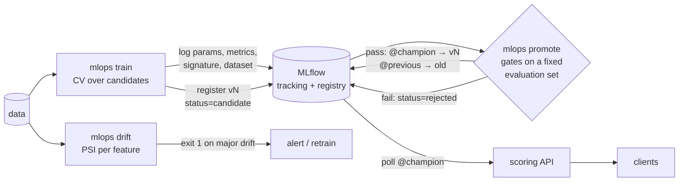

# mlops-platform


An end-to-end, self-hosted MLOps loop on MLflow for a credit-risk model: reproducible
training with lineage, **gated champion/challenger promotion**, drift monitoring and an online
scoring API that **hot-swaps models when the registry alias moves**, with no redeploy.

It's small on purpose: one `docker compose`, one CLI, a few hundred lines of Python. The goal is
to show the decisions that matter in production ML, not to wrap a framework.

## The loop



## What's in it

**Training** (`train.py`)
- Candidates (logistic regression, histogram gradient boosting) compared with stratified 5-fold
  CV; the best one is refit and scored on a holdout.
- MLflow lineage: parent run + nested run per candidate, git SHA, dataset logged as an input,
  model signature and input example, calibration table and evaluation summary as artifacts.
- The new version is registered as `status=candidate`. Training never touches production.

**Promotion** (`promote.py`)
- Challenger and champion are scored on the **same evaluation set that training never sees**
  (fixed split), so the comparison is fair.
- Gates: absolute AUC floor, minimum AUC gain over the champion, calibration (Brier) may not
  degrade, and a **fairness guardrail** on the AUC gap between age groups.
- Promotion is an alias move (`@champion`), the old champion becomes `@previous`, so
  `mlops rollback` is a single swap. Every decision is written to the version's tags.

**Responsible features** (`data.py`)
- `personal_status` (encodes sex) and `foreign_worker` are excluded from the model by design.

**Drift** (`drift.py`)
- Population Stability Index per feature (quantile bins for numeric, categories for
  categorical, unseen categories handled). `mlops drift` exits 1 on major drift, ready for cron.

**Serving** (`serve.py`)
- FastAPI with strict input validation, loads `models:/credit-risk@champion` and polls the
  alias: promotions and rollbacks go live in seconds with an atomic swap.
- `POST /admin/reload` forces a check; disabled unless `ADMIN_TOKEN` is set.

**Security note:** MLflow 3 serializes sklearn models with skops and refuses to load types that
a crafted file could abuse. Instead of disabling that, the pipeline trusts only the one type it
needs (`TreePredictor` for gradient boosting), and only the training job writes to the registry.

## Results on German Credit (OpenML `credit-g`)

| | ROC AUC | PR AUC | Brier |
| --- | --- | --- | --- |
| Logistic regression (5-fold CV) | 0.776 | | |
| Gradient boosting (5-fold CV) | **0.788** | | |
| Gradient boosting, holdout | 0.773 | 0.610 | 0.170 |
| Promotion eval set (unseen) | 0.766 | 0.629 | 0.170 |

Age-group AUC gap on the evaluation set: 0.004. A retrain on the same data is correctly
**rejected** by the gain gate (`0.7663 does not beat champion 0.7663 + 0.005`).

## Run it

```bash
docker compose up -d                       # Postgres + MLflow on :5000 (MLFLOW_PORT=5050 on macOS)
export MLFLOW_TRACKING_URI=http://localhost:5000

uv sync
uv run mlops train                         # → version 1 (candidate)
uv run mlops promote --version 1           # gates → @champion
uv run mlops drift                         # PSI report, exit 1 on major drift

docker compose --profile serve up -d       # scoring API on :8000
curl localhost:8000/predict -H 'content-type: application/json' -d @examples/applicants.json

uv run mlops rollback                      # swap @champion and @previous; the API follows
```

All commands print JSON on stdout, so they compose in pipelines (`mlops train | jq -r .version`).
`promote` exits 2 when the challenger is rejected.

## Development

```bash
uv run pytest      # full loop on a throwaway SQLite MLflow + synthetic data, ~1 min
uv run ruff check . && uv run mypy
```

The tests train real models and exercise promotion, rejection by each gate, rollback, the alias
hot-swap in the API and the CLI contract.

## License

MIT © Victor Gabriel Andrade de Melo
